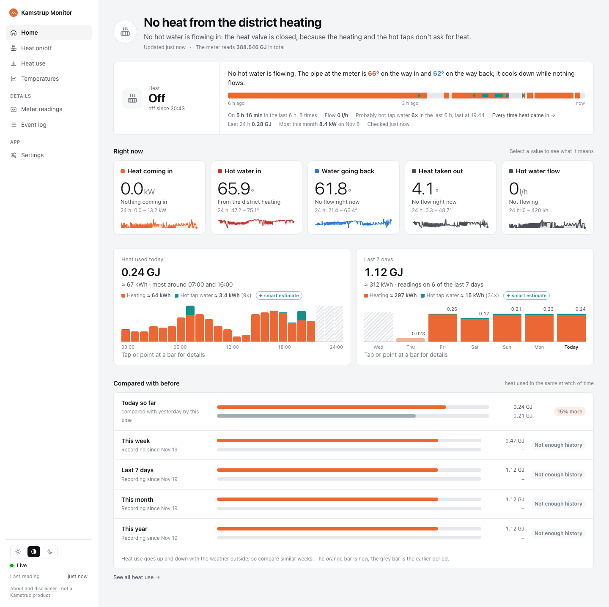
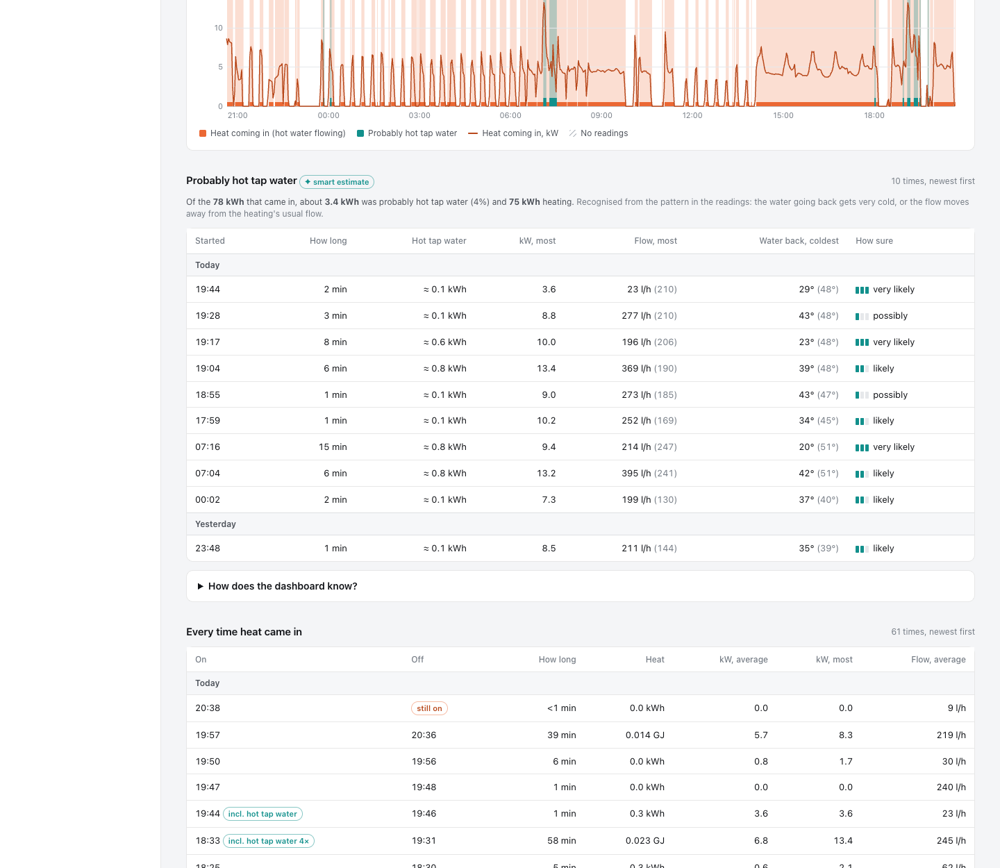
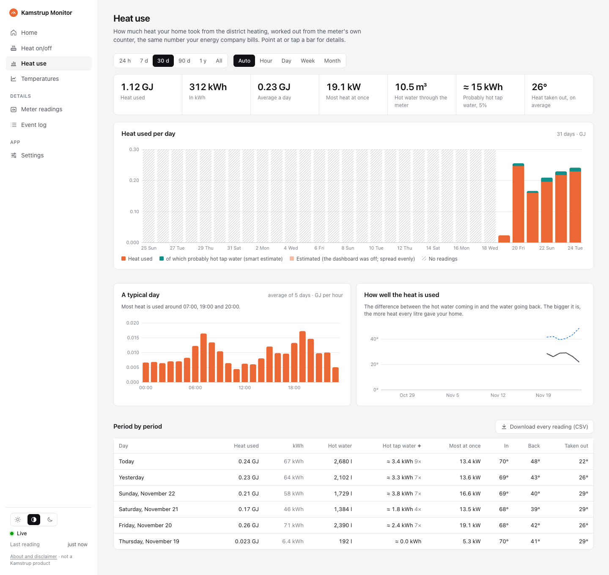
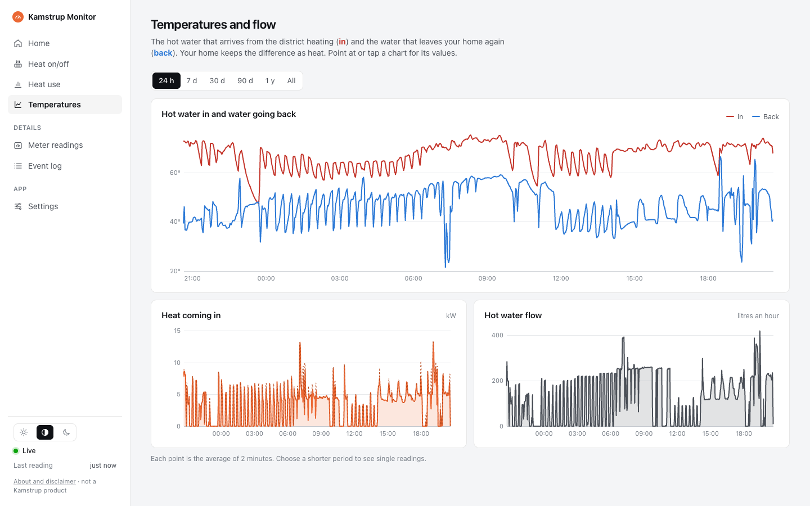
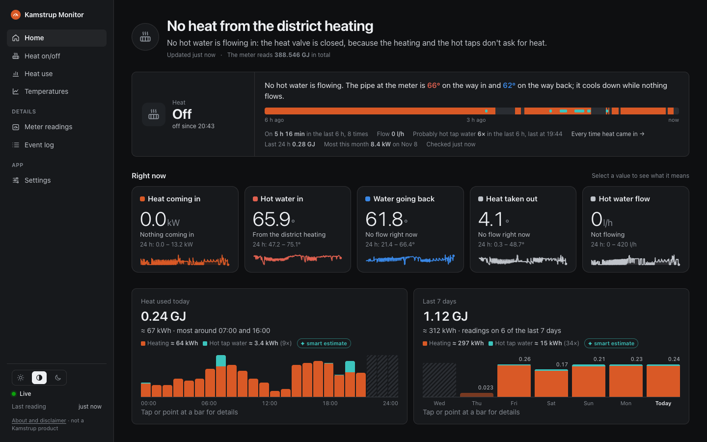
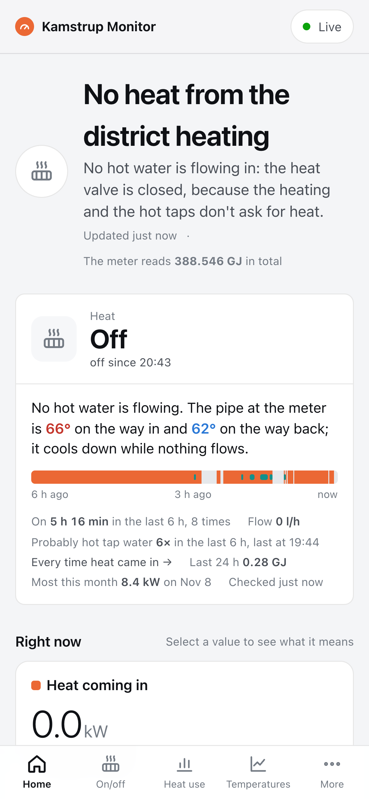
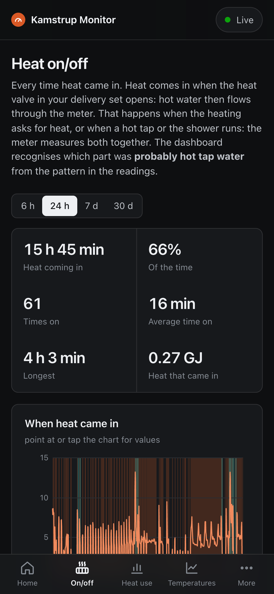

# Kamstrup Monitor

A local dashboard and history for a **Kamstrup MULTICAL heat meter** on district heating, read through the
[Smart Gateways Kamst-IR gateway](https://smartgateways.nl/en/product/kamst-ir-gateway-for-kamstrup-multical-meters/).



- **Home**: in plain words: is heat being used, how much, how well (the water going back), plus anything worth a look
  (gateway offline, weak WiFi, leak alarm, water going back too warm, firmware update).
- **Heat on/off**: whether heat is coming in right now (hot water flowing through the meter means the heat valve is open),
  since when, and every time it came on: how long, how much heat, average and highest kW. Plus every time it was
  **probably hot tap water** (a smart estimate, see below).
- **Heat use**: heat per hour / day / week / month from the meter's own counter, costs (optional), a typical day,
  comparisons with the previous period, and a table you can download.
- **Temperatures**: hot water in, water going back, heat coming in (kW) and flow, any period.
- **Meter readings**: every value the gateway reports, with what it means; the meter's own monthly and yearly records.
- **Event log**: lost contact, gateway restarts, firmware changes, alarms, new meter info events.
- **Settings**: the gateway's address (with a Test button), how often to read, GJ or kWh, price per GJ, how long to keep single readings,
  **Access** (sign-in on or off, password, read-only API keys, sign out) and **Home Assistant & MQTT**.

## Screenshots

| Heat on/off, with probably hot tap water | Heat use |
|---|---|
|  |  |
| **Temperatures and flow** | **Dark mode** |
|  |  |

On a phone, with a tab bar at the bottom (light and dark):

<p>
  
  
</p>

## History

Every reading is stored in `data/meter.db` (SQLite). Hourly totals are kept forever, also when you choose to thin out
old single readings. When the dashboard was off, the heat used in between is still counted (the meter's counter keeps
going) and spread evenly over the missing hours, marked as estimated.

## Hot tap water or heating? (a smart estimate)

With district heating, one meter measures all heat going into the heat unit (delivery set), which makes both the space
heating and the hot tap water. The meter can't tell them apart, so the dashboard **recognises** hot tap water from the
pattern in the readings (`app/tapwater.py`) and always shows it as an estimate ("probably", "≈"):

- It learns how the heating behaves: a moving average (about 40 minutes) of its usual flow, power and the
  temperature of the water going back, from readings that were not hot tap water.
- A shower or hot tap cools the heat unit with cold mains water, so the water going back gets **very** cold
  (28 °C or less, colder than the heating ever sends back), or cold with a flow far below the heating's usual flow.
  A tap running on top of the heating shows as a sudden jump in flow and heat with colder water going back.
  Signs at most 3 minutes apart are one use; anything over 45 minutes is taken to be heating.
- When only the tap takes heat, all of it counts as hot tap water; when the heating runs too, only the part above
  the heating's usual power.
- Every use gets a likelihood: very likely, likely or possibly.

For an exact split you'd need a second meter on the hot tap water.

## Sign-in

Sign-in is **on** by default. A new installation starts with the password `kamstrup` and asks for your own password
at the first sign-in. You can switch it off (and on again) under Settings › Access; both ask for the password.
To start without sign-in, set `REQUIRE_SIGNIN=false` in `.env`. Forgot the password? Set `RESET_PASSWORD=true`,
restart, sign in with `kamstrup`, choose a new one and remove the line again.

## Run with Docker

A ready-made image is built for every update of this repository (for amd64 and arm64, so also a Raspberry Pi):
`ghcr.io/ajin/smartgateways-kamstrup-monitor:latest`. Version tags (`v1.2.0`) also get their own image tag.

```bash
cp .env.example .env      # set TZ, and optionally GATEWAY=192.168.1.50:82
docker compose up -d
```

Open http://localhost:8080 and enter the gateway's IP address if you didn't put it in `.env`.

To update to the newest version:

```bash
docker compose pull && docker compose up -d
```

To build the image yourself from this folder instead, use `docker compose up -d --build`.

## Run without Docker

```bash
python3 -m venv .venv && .venv/bin/pip install -r requirements.txt
GATEWAY=192.168.1.50:82 PORT=8080 .venv/bin/python -m app.server
```

Data goes to `./data` (or `DATA_DIR`). The address can be changed any time on the Settings page.

## What the gateway sends

`GET http://<gateway>/kamst-ir/api/read` returns e.g. `heat_energy` (GJ), `power` (kW), `temp1` / `temp2` (°C, in / back),
`tempdiff`, `flow` (l/h), `volume` (m³), `hourcounter`, `infoevent`, the meter's monthly (`_m`) and yearly (`_y`) records
with dates as `YYMMDD`, and gateway details (`wifi_rssi`, firmware, MAC).

## API and API keys

Other applications (Home Assistant, Homey, scripts) can read everything over HTTP:

| | |
|---|---|
| `GET /api/meter` | Everything now, flat JSON with plain names: `heat_on`, `heat_on_since`, `power_kw`, `flow_lh`, `temp_in_c`, `temp_back_c`, `temp_diff_c`, `heat_energy_gj`, `heat_energy_kwh`, `today_gj`, `today_kwh`, `today_cost`, `volume_m3`, `online`, and the estimates `tap_water_now`, `tap_water_now_likelihood`, `tap_water_today_kwh`, `tap_water_today_uses`, `heating_today_kwh`, … |
| `GET /api/runs?hours=24` | Every time heat came in, with totals |
| `GET /api/tapwater?hours=24` | Every time it was probably hot tap water (estimate): start, minutes, kWh, likelihood, and the split hot tap water / heating |
| `GET /api/usage?hours=720&group=day` | Heat used per hour / day / week / month |
| `GET /api/series?hours=24` | Power, temperatures and flow over time |
| `GET /api/summary` | Today, the last 7 days, comparisons |
| `GET /api/state`, `/api/events`, `/api/export.csv` | Raw latest reading, event log, every reading as CSV |
| `POST /api/refresh` | Read the meter now |

With sign-in on, create a key under **Settings › Access › API keys** and send it as `Authorization: Bearer <key>`
or `X-API-Key: <key>`. Keys are read-only and can never change settings, passwords or keys. The key is shown once;
only its hash is stored (`data/apikeys.json`). With sign-in off, the API is open to your network without a key.

```bash
curl -H "Authorization: Bearer km_…" http://localhost:8080/api/meter
```

## MQTT (Home Assistant, Homey)

Under **Settings › Home Assistant & MQTT**, enter your broker (in Home Assistant: the Mosquitto add-on). After
every reading the dashboard publishes, retained:

- `kamstrup_monitor/state`: the same JSON as `/api/meter`
- `kamstrup_monitor/status`: `online` / `offline`

Home Assistant finds one device, **Kamstrup heat meter**, by MQTT discovery: heat coming in (kW), heat used (GJ and
kWh, usable in the Energy dashboard), heat used today, hot water in / going back, heat taken out, flow, water through
the meter, a **Heat coming in** binary sensor, a leak alarm and diagnostics (WiFi, running time, gateway connection), plus the
estimates **Hot tap water (probably)** (on/off), **Hot tap water today (estimate)** and **Space heating today (estimate)**.
Homey (MQTT Hub / MQTT Client) and others can subscribe to the state topic. Nothing can be changed over MQTT.

## License

GPL-3.0-or-later (see [LICENSE](LICENSE)). Not affiliated with Kamstrup or Smart Gateways.
